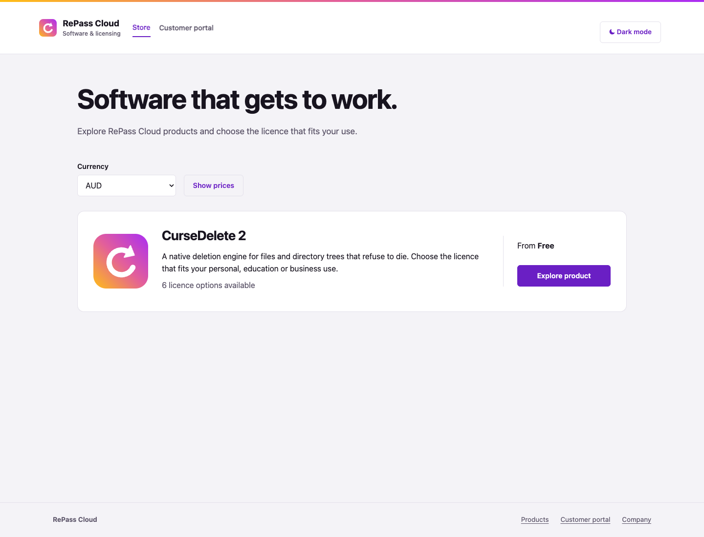
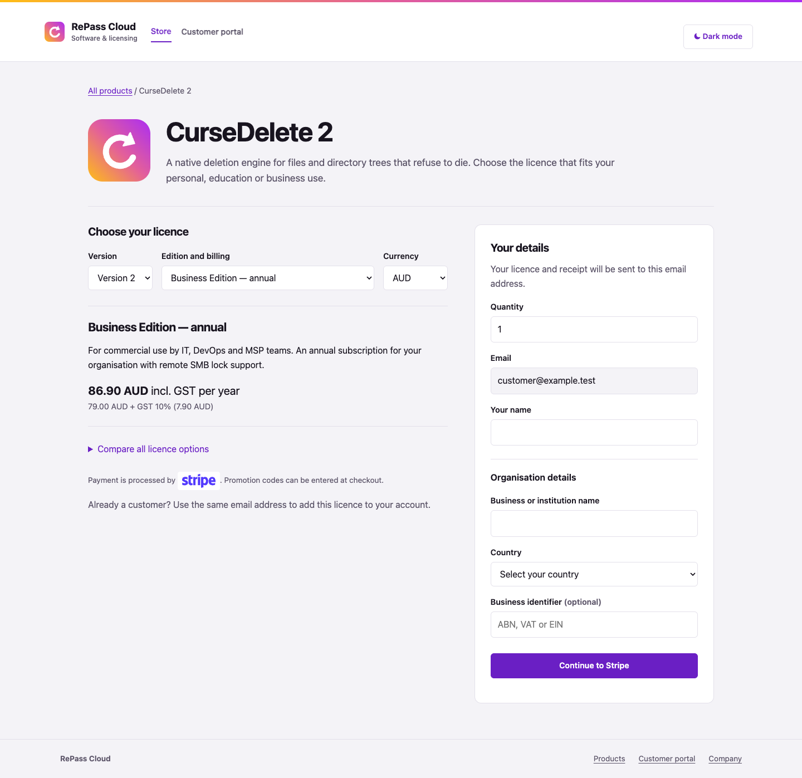
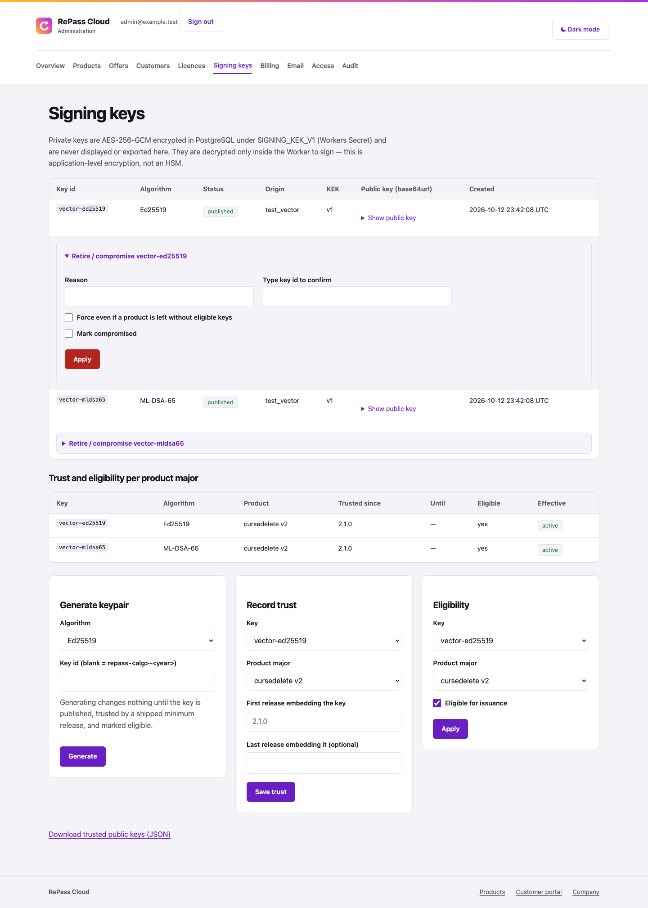
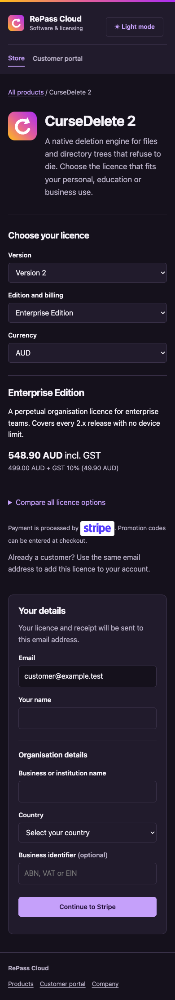

# Interface review — 13 October 2026

These screenshots use a disposable local PostgreSQL database and synthetic catalogue/customer data. They show the real Hono views, shared styles and browser script. The product artwork in this fixture is the RePass Cloud mark; production artwork is configured separately on the product.

Browser review covered the store, product detail, customer licences and all ten admin sections at 1440px; mobile store, product, customer and signing-key pages at 390px. No page overflow or browser script errors were found. Signing-key action disclosure was inspected open. Edition switching updated the description, price, SKU, quantity bounds and organisation fields. Currency selection changed the displayed price and checkout currency. Version switching selected an available offer in the new major. The theme preference survived reload. The GET selection flow also worked with JavaScript disabled.

## Store

## Product and checkout

## Signing keys

## Mobile dark theme

