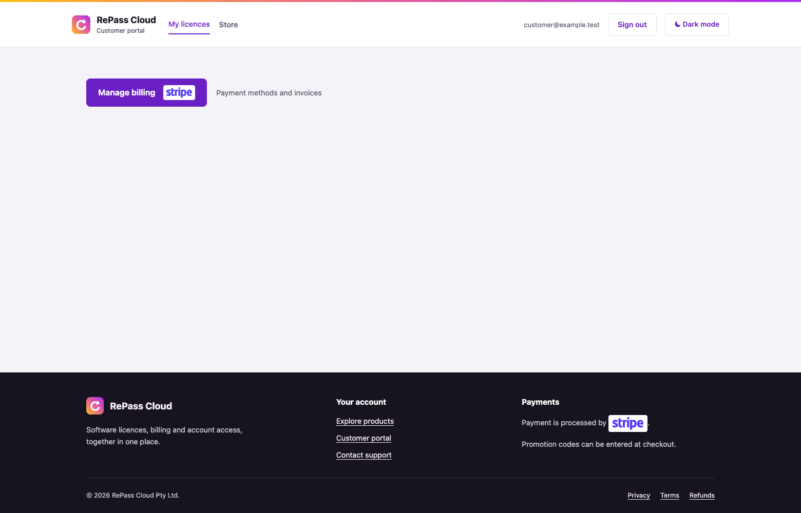
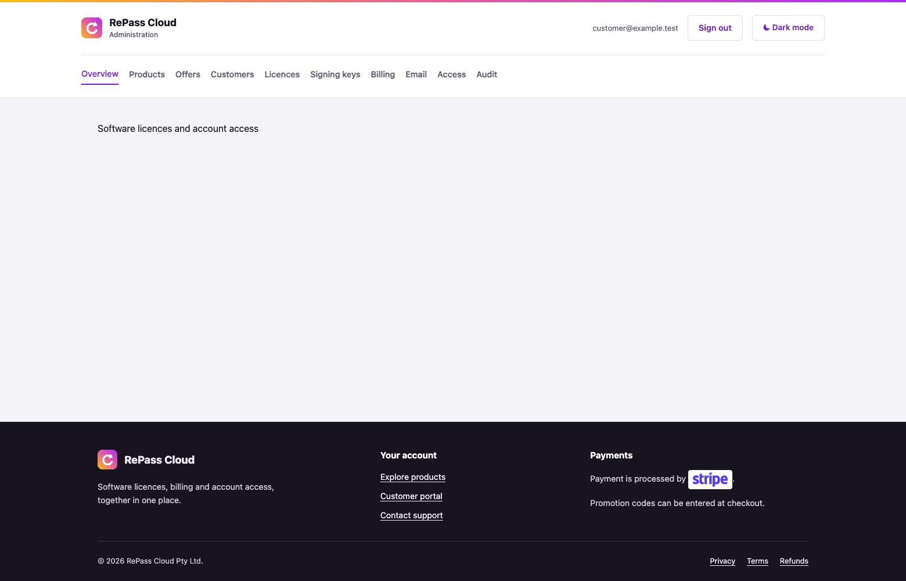
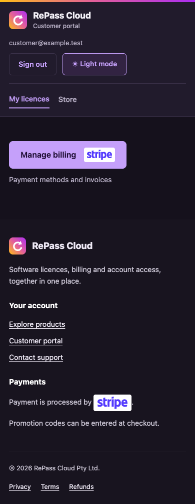

# Shared header, footer and billing action

These local Chrome component fixtures render the actual Layout, BillingAction, CSS and JavaScript with a synthetic signed-in account. They isolate the shared chrome; they are not screenshots of live authenticated customer data.

Browser assertions check desktop account-control centre alignment and equal button heights, footer-only payment attribution, one company-root link, a filled billing button, theme switching and no mobile horizontal overflow.

