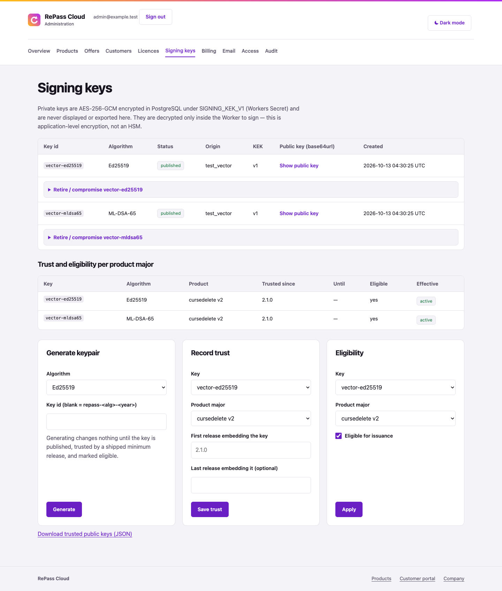
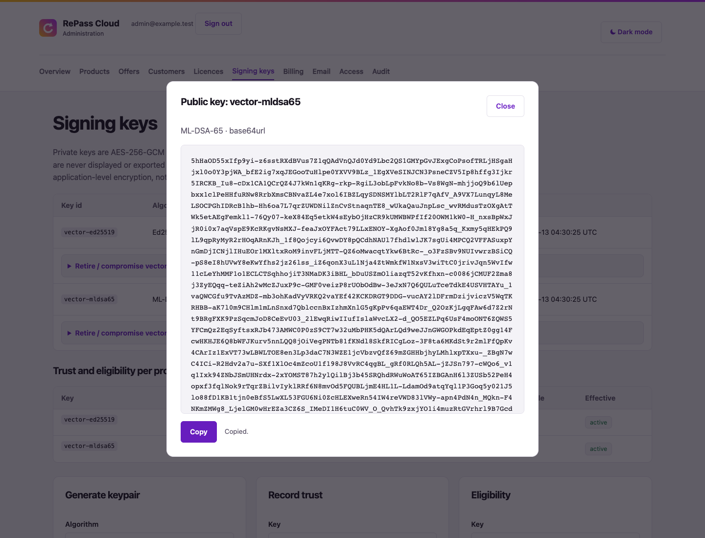
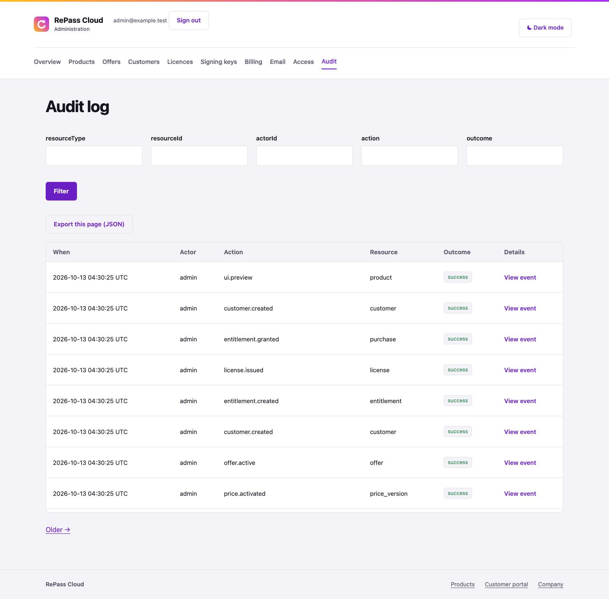
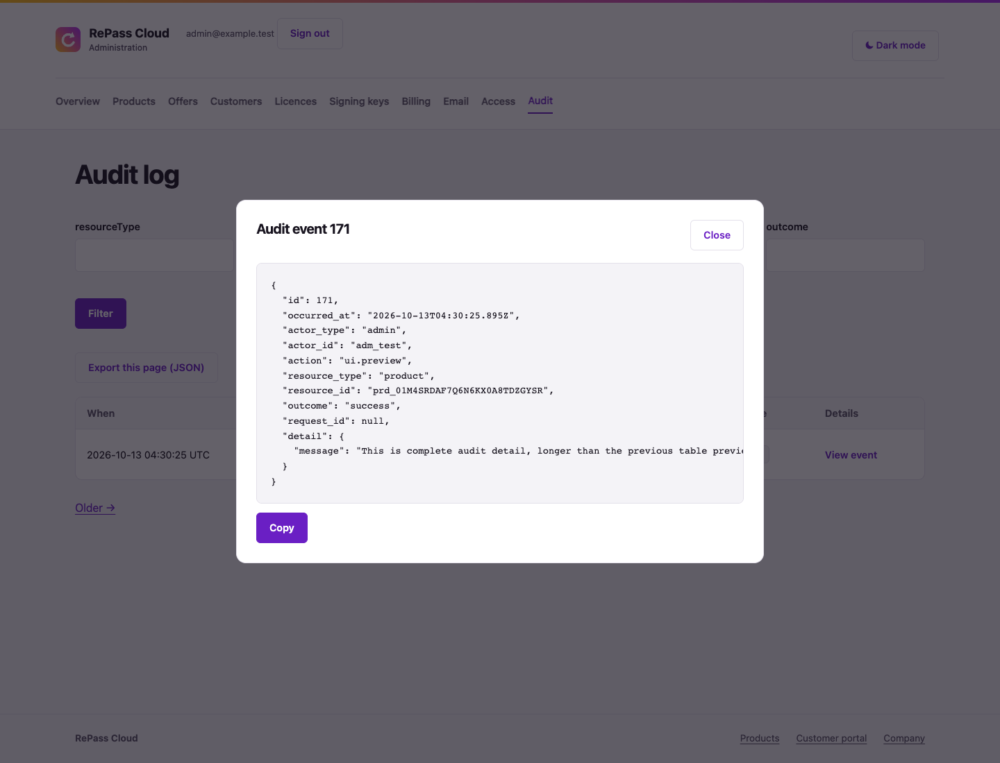
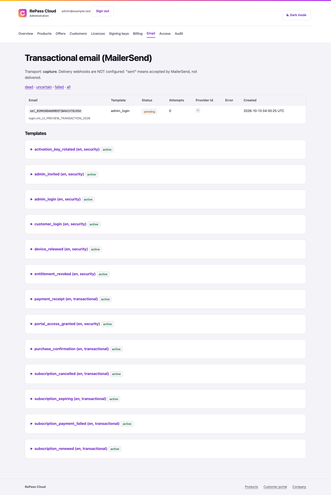
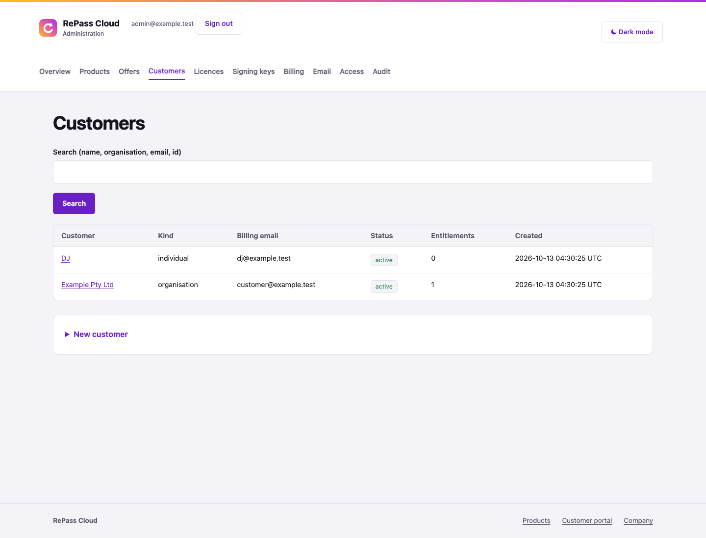
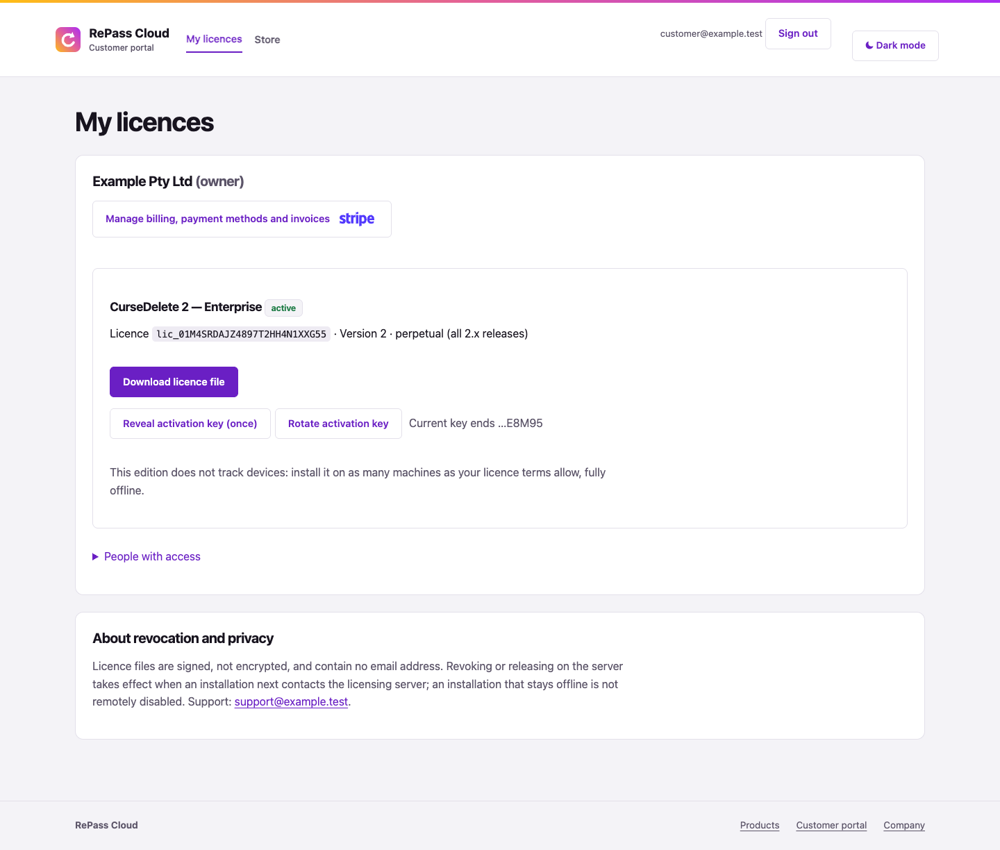
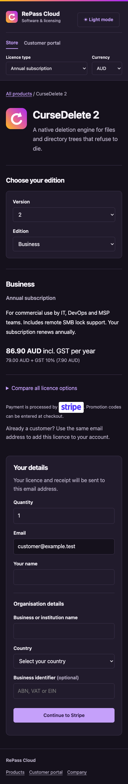

# Interface refinements — 13 October 2026

These renders use the real Hono views with a disposable local PostgreSQL database, synthetic customers and public test-vector keys. The product mark is fixture artwork.

Browser checks confirmed unchanged table-column widths while showing/copying the largest public key, exact clipboard contents, Escape/close support, equal key-form heights and aligned buttons, complete audit details and filtered JSON export. Numeric versions, separate editions and header licence/currency controls select the correct checkout SKU and requirements. Currency changes update selected/comparison/catalogue prices and links without loading another document. Mobile pages fit the viewport, and edition/version/public-key fallback pages work without JavaScript.

Fixed-term choices retain their explicit duration when switching versions. The full repository suite passed with the pinned real-client checker; its checker-unavailable sentinel is intentionally skipped. Node's existing experimental Web Crypto warnings remain.

## Product page

## Key forms and overlay

## Audit and event detail

## Email, customers and billing

## Mobile

